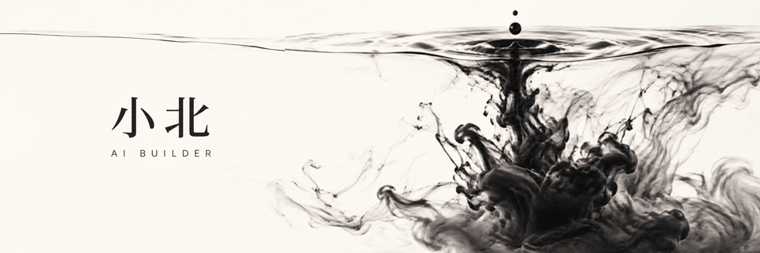

# 你好，我是小北 👋

**AI Builder · AI Coding · Agents · AIGC · Automation**

我喜欢把 AI 想法做成可以体验的小工具，探索从自然语言到创作、工作流与自动化的过程。

I build practical AI demos and learn in public.

## Selected projects

| 项目 | 做什么 |
| --- | --- |
| [AI Video Director](https://github.com/cvcingcvc-code/ai-video-directo) | 将自然语言创意整理成分镜与视频模型可用的提示词。 |
| [Emotion Content Studio](https://github.com/cvcingcvc-code/emotion-content-studio) | 面向英语学习内容的小红书内容生成工作流 Demo。 |
| [Math](https://github.com/cvcingcvc-code/math) | Python 数学探索与尝试。 |

## What I'm exploring

- AI coding：把想法变成可运行的原型。
- Agents & automation：探索 AI 与工作流的结合。
- AIGC：探索内容和视频创作工具。

## Let's connect

欢迎通过相关项目的 Issues 交流想法、反馈和问题。
