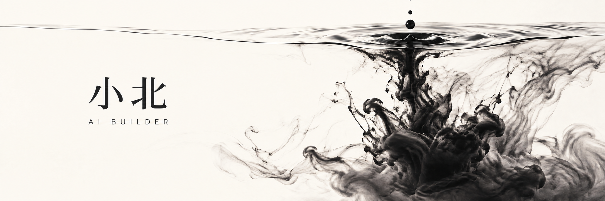

# 你好，我是小北 👋

**把 AI 想法做成可以体验的小工具，探索从自然语言到创作、工作流与自动化的全过程。**

I build practical AI demos and learn in public.

---

## 🚀 精选项目

| | |
| --- | --- |
|  |  |
|  |  |
|  |  |

---

## 🧭 我在做什么

### 🤖 AI Agent 与工作流
- **[Gorgon Workbench (cec)](https://github.com/cvcingcvc-code/cec)** — 个人 AI 行动工作台：任务、日程、知识、研究与智能体协作，支持 Android（Capacitor）。
- **[Agent Growth Foundry](https://github.com/cvcingcvc-code/agent-growth-foundry)** — AI 自成长产品工厂：多智能体协作、许可证初筛、数据准入、小模型训练与评测。
- **[DeepSeek Harness 相关实践](https://github.com/cvcingcvc-code)** — 探索"一切皆插件"的智能体架构。

### 🎨 AIGC 内容创作
- **[AI Video Director](https://github.com/cvcingcvc-code/ai-video-directo)** — 把自然语言创意整理成分镜与视频模型（Kling / Veo / Sora）可用的提示词。
- **[Emotion Content Studio](https://github.com/cvcingcvc-code/emotion-content-studio)** — 面向英语学习内容的小红书内容生成工作流。
- **[销售神队友](https://github.com/cvcingcvc-code/salesmate-ai)** — 企业销售话术训练 AI：先被 AI 客户"虐"一百遍。

### 🛡️ 安全与量化
- **[Sentinel 网络安全智能体](https://github.com/cvcingcvc-code/jumping_candy)** — DeepSeek + LangGraph 流量日志分析：攻击检测 → 类型判定 → IP 溯源 → 安全报告。
- **[Binance 量化交易系统](https://github.com/cvcingcvc-code/bianlianghuajianyi)** — Node.js 币安合约量化框架。
- **[SlotShift · Monad 并行架构实验室](https://github.com/cvcingcvc-code/blitz)** — 可视化模拟 + 真实测试网交易，讲清楚智能合约的状态访问冲突。

### 🎮 小玩意儿
- **[Card Battle Game](https://github.com/cvcingcvc-code/card-battle-game)** — 浏览器卡牌对战原型 + 微信小程序。
- **[Gorgon Demo MVP](https://github.com/cvcingcvc-code/geergong)** — "发现你的周末" 3 分钟可演示交互原型。
- **[教育 AI 证据可靠性评估](https://github.com/cvcingcvc-code/math)** — 数学建模黑客松赛道一参赛作品。

---

## 🛠️ 技术栈

---

## 📊 GitHub 统计

### 🐍 贡献格子贪吃蛇

<picture>
  <source media="(prefers-color-scheme: dark)" srcset="https://raw.githubusercontent.com/cvcingcvc-code/cvcingcvc-code/output/github-contribution-grid-snake-dark.svg" />
  <source media="(prefers-color-scheme: light)" srcset="https://raw.githubusercontent.com/cvcingcvc-code/cvcingcvc-code/output/github-contribution-grid-snake.svg" />
  
</picture>

*由 GitHub Actions 每天自动更新。*

---

## 🌱 正在探索

- **AI Coding** — 把想法变成可运行的原型，让代码跟着自然语言走。
- **Agents & Automation** — 探索 AI 与工作流的深度结合。
- **AIGC** — 内容与视频创作工具链。
- **小模型训练** — LoRA 微调、数据迭代与本地推理。

---

### 💬 Let's connect

欢迎通过任意项目的 [Issues](https://github.com/cvcingcvc-code) 交流想法、反馈和合作。

⭐ *如果某个项目对你有帮助，欢迎点个 Star！*

